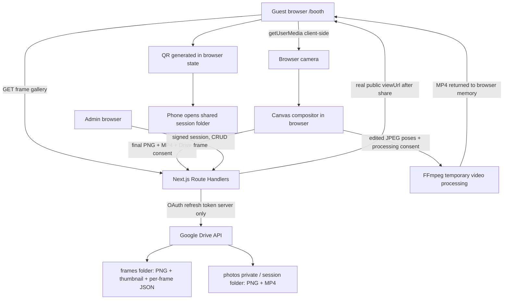

# 02 — Technical Architecture (no database)

## 1. Komponen



**Important:** The diagram shows persisted templates and photos in Google Drive, not in a local database. The QR is an in-memory representation of a URL, NOT a permanent record.

## 2. Responsibility split

| Frontend                                | Server                                   | Google Drive                      |
| --------------------------------------- | ---------------------------------------- | --------------------------------- |
| Camera + countdown + photos in memory   | Auth admin & cookies                     | Frame overlay assets & thumbnails |
| Frame preview + photo strip composition | Validate request/schema/MIME/size        | One JSON config per frame         |
| Retake & filters                        | Files list/read/upload/update/delete     | Final photo strip image           |
| QR generation from returned URL         | Permissions share/read verification      | Ownership, capacity & ACL         |
| User notices & error UX                 | Sanitized errors + best-effort throttles | View/download URL                 |

## 3. Drive file conventions

**Drive root** created on behalf of OAuth operator. `drive.file` scope works for files created/opened by the application. `frames/` contains `<frameId>.json`, `<frameId>-v1-overlay.png`, `<frameId>-v1-thumb.webp` etc. `photos/` stays private and contains session folders `Hoya-Hoya-<YYYY-MM-DD>-<uuid>/`, each with `kolase.png` and `boomerang.mp4`. Only the session folder is shared. Frame metadata JSON references immutable asset versions; no global manifest or database.

### Public gallery read

1. Backend lists JSON configs in `frames/` (by controlled folder ID and `name` suffix .json / MIME).
2. Reads & validates JSONs. Cache for e.g. 30 seconds, and invalidate on publish if supported.
3. Returns only published metadata with **internal same-origin** asset URLs (server proxy). Do not expose file tokens.
4. App reads overlay/thumbnail through restricted proxy endpoint using published config. Avoid generic `?fileId=` proxy.
5. For admin, include drafts only after valid login.

**Scaling limit:** one JSON per frame makes several Drive API reads. Acceptable for small collections and MVP. For 100s/1000s of frames, use Drive appProperties indexing, object storage/CDN or persistent indexing service. Never introduce a DB secretly.

### Public photo write

1. Render full PNG locally. PNG download does not send any photo to the server.
2. On preview/download video or Drive save, render edited portrait poses in the browser, send them to `/api/boomerang`, and receive a six-second MP4 back into browser memory. Bounded temporary files are deleted in `finally`; two jobs per process, timeouts, no shell commands, no database.
3. After explicit Drive consent, send PNG + MP4 to `/api/photos`; verify both media streams before any Drive mutation.
4. Create a private session folder under private `photos/`, upload the two files, then set `anyone:reader` on **that session folder only**. Verify inherited public access on both children.
5. Return the actual Drive folder `webViewLink` only after all steps succeed. Roll back the session best-effort on partial failure; never return a QR for incomplete results.
6. Client validates the exact Drive folder ID and generates QR. Original captures are not stored in Drive. Browser photos/MP4/QR disappear on refresh; uploaded Drive files remain. Request loss can still create a duplicate folder on manual retry.

### Per-file public link risks

The Google Drive result remains retrievable if link was copied or scanned; closing the photobooth tab does not revoke access. User photos are not guaranteed private because links can be forwarded. Show the consent clearly and document operator deletion/retention.

## 4. Admin frame lifecycle

```
NEW → DRAFT → PUBLISHED → UNPUBLISHED → PUBLISHED
                   └── (soft archive / delete)
```

Use immutable `overlayFileId` on each edit. On update create v2 asset, update JSON only after new asset passes upload and validation. When a guest selects a published frame, fetch and retain the selected overlay as a Blob in client memory for the whole capture/edit/export flow; do not fetch again just before export. Existing user sessions should therefore finish even if the admin unpublishes or updates the frame while the session is active. Retain previous overlay assets for a safe transition period as well. Do not immediately purge older overlays; keep N versions or delayed/manual cleanup. Use `updatedAt` and a `revision` integer for basic optimistic concurrency on admin writes: reject outdated edit with 409. This does not ensure perfect CAS across serverless with Drive; document concurrent admin limitation and prefer single admin for MVP.

## 5. Runtime & modules suggested

```
src/
  app/
    page.tsx
    booth/page.tsx
    admin/login/page.tsx
    admin/page.tsx
    admin/frames/new/page.tsx
    admin/frames/[id]/edit/page.tsx
    api/frames/route.ts
    api/frames/[id]/route.ts
    api/frames/[id]/asset/[kind]/route.ts
    api/photos/route.ts
    api/admin/login/route.ts
    api/admin/logout/route.ts
    api/admin/frames/route.ts
    api/admin/frames/[id]/route.ts
  components/{landing,booth,camera,frame-builder,shared}/
  lib/
    auth/{cookie,password,csrf}.ts
    drive/{client,folders,frames,photos}.ts
    storage/{interface,google-drive,mock}.ts
    schemas/{frame,api}.ts
    compositor/{geometry,render}.ts
    uploads/{validation}.ts
    qr/{urls}.ts
  hooks/{useCamera,useBoothSession}.ts
  tests/
  scripts/{generate-admin-hash,google-auth,drive-bootstrap}.ts
```

Exact folders can differ if code stays organized.

## 6. Cache, consistency and rate limits

- Public frame listing 30-second (configurable) TTL, stale assets use versioned file IDs.
- Never cache admin responses or auth as publicly shareable content.
- Cache private frame proxy in CDN only for `published` assets with immutable versioned URL; do not allow unpublish leak assumptions: cached thumbnails may persist until TTL.
- Rate limits: local in-memory throttles are only best-effort; serverless multi-instance needs provider WAF/rate limit/CDN or a distributed tool (out of scope without DB). Optionally integrate Turnstile, no hidden state store.
- For concurrent uploads & Drive quota 429/5xx, bounded exponential backoff; log request outcomes minus secrets.

## 7. Dependencies on external environment

- OAuth 2.0 client ID/secret & refresh token owned by operator.
- Folders created/registered by app bootstrap within Drive account.
- Enough Drive storage. `anyone-with-link` must be allowed by Google account / Workspace policies.
- Upload payload limits of selected deployment platform; don't assume every serverless provider can accept 12 MB requests. Document safe max per provider. Consider compression or direct signed upload via appropriate storage in future.

## 8. What not to implement

No guest user DB, no gallery of previously captured user photos, no admin-managed events DB, no `localStorage` to persist QR. Do not leak unauthorized draft assets through generic backend proxy. Do not use service account with personal My Drive as default (quota/ownership constraints).
